# 우리집 호스트 연결·AI 파이프라인 설계

2026-11-01 / 설계 제안. 앱 `민경민@ef47b6a`, 엔진 `codex/relationship-ai@8b4d551`을 읽어 작성했다. 현재 구현된 함수는 [INTEGRATION.md](INTEGRATION.md), 화면 계약은 [PRODUCT-FLOW.md](PRODUCT-FLOW.md). 아래 호스트 객체·명령·상태는 새 구현 제안이며 기존 API라고 주장하지 않는다. 전체 앱 REST API·DB DDL은 확정하지 않는다.

## 1. 브랜치 통합 방식

`git fetch origin`으로 확인한 원격 작업 브랜치는 `codex/relationship-ai`, `민경민`이다. 전자는 Git author ZIS25K, 후자는 brianmin11의 커밋으로 구분된다. 로컬 `codex/rai-*`, `codex/eval-recovery-*`는 기존 AI 작업용 브랜치다.

저장소는 shallow가 아니며 `git merge-base`가 두 브랜치의 공통 조상을 찾지 못했다. 두 루트 모두 `package.json`, lockfile, tsconfig, README를 갖지만 하나는 Next 앱, 하나는 독립 TS 패키지다. 따라서 `--allow-unrelated-histories`로 전체 파일을 덮어 병합하기보다 다음 통합을 권장한다.

1. 팀이 앱 기준 SHA를 고정하고 **앱 브랜치 기반 별도 `codex/` 통합 브랜치**를 만든다. 이번 설계에서는 만들거나 병합하지 않았다.
2. AI 소스·테스트·스키마를 `packages/relationship-ai`로 가져와 출처 SHA를 기록한다. 앱 루트와 의존성/lockfile은 메인이 한 번 통합한다. 평가 결과와 CLI는 앱 실행 경로와 분리한다.
3. 패키지는 서버에서만 import한다. 브라우저에는 별도 허용된 화면 DTO/타입만 전달한다. OpenAI 어댑터·Node crypto·키·비공개 파생 메타데이터를 client bundle에 넣지 않는다.
4. 패키지 build → 앱 build 순서와 ESM exports를 확인한다. 엔진 Node>=22, TS7와 앱 TS5/@types-node20의 실제 호환을 검증하고 빌드 구성을 정한다. 숫자만 보고 호환된다고 가정하지 않는다. 앱의 Next 전용 AGENTS 안내대로 구현 시 설치된 Next 문서를 읽는다.
5. 기존 UI 파일·MASTER·전역 토큰은 유지한다. AI 패키지의 루트 설정으로 앱 설정을 교체하지 않는다. `.env.local`, `.git`, `node_modules`, 실제 개인 데이터는 복사 대상이 아니다.

패키지 디렉터리 통합은 제안이며 아직 이동하지 않았다. 공개 npm 배포나 별도 AI HTTP 서버는 필요하지 않다.

## 2. 파이프라인과 신뢰 경계

```mermaid
flowchart LR
  UI[브라우저: 사용자 입력·명시적 액션] --> HOST[호스트: 인증·권한·버전·예산 예약]
  HOST --> PRIVATE[개인 Context Builder]
  PRIVATE --> PERSONAL[personal / share]
  PERSONAL --> PD[개인 초안 저장·조회]
  PD --> REVIEW[작성자 검토·공유 승인]
  REVIEW --> CARDS[승인된 공유 카드 저장소]
  CARDS --> JOINT[공동 Context Builder]
  JOINT --> AI[analyze / propose / revise]
  AI --> COMP[compileChangePlan: 실행 불가 초안]
  COMP --> RESOLVE[호스트: 조건 확정·실행 계획 버전]
  RESOLVE --> ACCEPT[인증된 당사자별 수락]
  ACCEPT --> EXEC[최신 권한·출처·충돌 재검증]
  EXEC --> DB[일정·할 일 트랜잭션]
  DB --> OUTBOX[알림 outbox / 중복 방지]
```



공동 Context Builder에는 개인 대화 저장소 읽기 경로를 주지 않는다. 동일 가구여도 수신자·목적이 다른 카드를 함께 넣지 않는다. 브라우저의 userId/householdId/approved/hostVerified는 신뢰하지 않는다. 서버가 세션·멤버십·공유 승인을 조회해 Context를 만든다.

호출 전 예산을 예약하고, 결과 저장 전에 권한 epoch·출처 revision·취소 상태를 다시 검사한다. 생성 도중 공유가 철회되면 늦게 도착한 결과를 노출하지 않는다. 외부 모델에 이미 전송된 입력의 회수는 보장하지 않는다. 원문/모델 원시 오류는 일반 로그에 남기지 않는다.

## 3. 화면 액션 → 호스트 명령 → 엔진

명령 이름은 서비스 레이어의 설명용 이름이다. transport는 다른 개발자가 앱 구조에 맞춰 정하며 여기서 HTTP 경로를 선결정하지 않는다.

| 화면 액션 / 제안 명령 | 호스트가 받는 최소 요청 | 서버가 읽고 검증하는 것 | 현재 엔진 / 저장·반환 |
|---|---|---|---|
| S02 정리 `ReflectPrivateInput` | sessionId 또는 새 입력, text, 선택 route, expectedRevision, requestId | 로그인한 소유자, 현재 요청, 기억 사용 설정, 선택된 허용 기억, now/timezone, 예산 | `personal`; 개인 `value` + 비공개 lineage 저장. 화면에는 본인용 DTO |
| S03 답변 `ContinuePrivateInput` | 현재 작업의 명시적 답변/수정 | 현재 대화 범위, revision, clarificationTurns | 자동으로 과거 이력 전부를 넣지 않음. 현재 사용자가 제공한 문맥과 후속 기억을 구분해 `personal` |
| S04 다듬기 `DraftShare` | privateSessionId, 수신자 선택, 목적, constraintsOnly | 소유자, 사용자 route 변경, 유효 수신자 | `share`; 미승인 개인 초안. 모델이 발송하지 않음 |
| S04 발송 `ApproveShare` | draftId, expectedRevision, 최종 exactText, recipients, purpose, 유효기간 선택 | 소유자·목적·허용 수신자·정확한 버전·중복 요청 | **모델 없음**. 수정은 새 버전, 인증된 승인 기록과 공유 카드 생성. 개인 원문 ID/metadata를 공동 DTO에 복사하지 않음 |
| S05 답변 | receivedCardId, route 선택 | 수신 권한·현재 카드 상태 | 상대 카드가 내 개인 이력으로 자동 수입되지 않도록 명시적 사용 범위 구성. 답변도 내 초안→별도 공유 승인 |
| S06 쟁점 `AnalyzeCoordination` | coordinationId, expectedRevision | 조율 audience/purpose, 유효 승인 카드, 최소 허용 일정 | `analyze`; 공동 결과 저장. 한쪽 입장 미확인 유지 |
| S06 초안 `ProposeAgreement` | coordinationId | 동일 context snapshot, 새 agreementId/revision1 | `propose`; `IssueAnalysis`를 입력으로 받는 함수는 아님. 동일 공동 입력에서 독립 생성 |
| S07 수정 `ReviseAgreement` | agreementId, expectedRevision, 공유 확인된 instruction 또는 defer/decline | 인증 actor, SharedPrior의 실제 hash/최신 revision/lineage | `revise`; 새 버전. 원시 개인 입력을 feedback.instruction에 넣지 않음. 이전 수락 승계 금지 |
| S07 조건 확정 `ResolveExecutionTerms` | draftId/revision, 수정한 구조화 필드 | 영향받는 당사자, 허용 target, 필수값, 시간·반복·전체 참여자 충돌 | 아래 새 호스트 resolver. 모델 없이 실행 계획 생성, diff 반환 |
| S08 수락 `AcceptExecutionPlan` | planId/revision/digest, expectedAgreementRevision, requestId | 로그인 actor가 requiredAcceptors에 포함, 최신 계획, hardValidationBlockers=0 (pendingConsent는 허용) | **모델 없음**. 인증된 수락 기록. 발화 분석으로 수락하지 않음 |
| S08 반영 `ApplyAcceptedPlan` | planId/revision/digest, requestId | 전원 동일 버전 수락, 현재 권한·source/target revision, 상태, 충돌 | 호스트 transaction + outbox; 저장 후 read model 재조회 |
| S10 삭제·철회 | 대상 id, expectedRevision, 요청 종류 | 소유권과 승인 기록, 처리 대상 범위 | 호스트 저장/캐시/파생 무효화. `invalidatedArtifacts`는 영향 탐색 보조이며 실제 삭제가 아님 |

조율의 `participantIds`는 가구 전체 명단이 아니라 해당 작업의 명시적 audience다. actor도 포함한다. 새 참여자를 추가하면 기존 카드의 수신 승인 범위를 확장해 해석하지 않고 다시 승인받는다. 공동 모델에 들어가는 각 카드가 모든 audience에게 허용돼야 한다.

## 4. 필요한 데이터 연결

아래는 저장 책임과 관계를 명확히 하기 위한 최소 개념이다. 전체 DB 테이블 명세가 아니다.

| 데이터 | 현재 앱 → 필요한 확장/매핑 | 경계 |
|---|---|---|
| FamilyMember / viewer | fixture `viewerId`, 문자열 `role` → 인증된 memberId, householdId, 실제 capability | 표시 역할·부모/결제자 여부로 개인 열람권을 만들지 않음 |
| ScheduleItem | `startsAt`→`start`, `memberIds`→`participantIds`; `end`, revision, timezone, visibility 추가 | 없는 종료 시각을 30분/1시간으로 임의 채우지 않음. 읽기 권한 있는 일정만 모델 projection |
| ChoreItem | id/title/assignee/done → revision, 기한·반복·예외·완료 기록·originPlanId | 기존 가사 변경 target 계약은 현재 AI가 지원하지 않음. 별도 명령 필요 |
| PrivateSession / artifact | owner, 현재 source/revision, historyStored, memoryEnabled, 개인 결과/lineage | 본인만. 가족 관리자 화면·공유 캐시에 노출 금지 |
| ShareApproval / shared card | 정확한 문구·수신자·목적·revision·유효기간·actor·승인 시각·상태 | 원문과 분리된 공유 객체. private→shared의 연결 lineage는 서버 제한 영역에서만 보관 |
| Coordination | household, audience, purpose, permissionEpoch, 현재 카드 revision 목록, 상태 | 읽기마다 현재 권한 검사. 변경으로 인해 stale이면 다시 생성 |
| AgreementArtifact | id/revision, draft, shared metadata, contentHash, latestRevision | 원문 아닌 공유 출처만. 수락과 별도 객체 |
| ExecutionPlan / Acceptance / Execution | 아래 불변 실행 snapshot, 당사자 수락, 저장 결과와 operation 식별자 | 모델 쓰기 권한 없음. 실행 결과가 일정/할 일과 추적 가능해야 함 |
| Notification | 허용 대상, 종류, 대상 id/revision, 딥링크, 읽음·발송 상태 | 표시 text를 LLM 자유 출력으로 발송하지 않음. 알림 payload는 최소 정보 |
| UsageReservation / ModelRun | 가구·행위자·requestId, 예약/관측 비용, nullable usage, 모델·단가 버전 | 공개 가족 대시보드에 개인 대화 이용 내역을 추론시키는 세부 계측을 노출하지 않음 |

일정에 작업 audience 밖 구성원이 포함되면 명단만 잘라 안전해졌다고 간주하지 않는다. 서버가 열람 가능한 범위로 투영하거나 제외하고, 전체 참여자 충돌은 실행 직전 서버가 별도로 검사한다. 비공개 일정 충돌은 일정 제목·내용 대신 ‘선택한 시간에 반영할 수 없어요’ 같은 제한된 결과로 반환한다.

`MemoryItem`(사진/추억)은 AI의 `Source`/개인 기억으로 자동 변환하지 않는다. `lib/format.ts`의 현재 Asia/Seoul 표시와 서버 `Scope.timezone`을 일치시키되 시간대 확장 시 한 설정에서 읽는다.

## 5. 제안 → 실제 실행 사이의 핵심 계약

### 현재 엔진이 하는 일

`compileChangePlan`은 `basis=proposed`, 미정값, 시간/반복/충돌 등에 blocker를 붙이며 항상 `executable:false`를 반환한다. `verifyAcceptanceVersion`은 draft의 agreementId/revision/semanticHash만 비교한다. 로그인 여부·전원 수락·실행 명령은 검증하지 않는다.

따라서 ‘수락했으니 blockers를 삭제’, `basis`를 임의로 sourced로 변경, `executable=true` 강제 캐스팅은 연결 방법이 아니다. LLM에 한 번 더 물어서 수락 기록을 만들지도 않는다.

### 권장: 호스트의 별도 확정 계획

새 `ExecutionPlan` 개념을 둔다. AI draft는 원본 그대로 보존하고, 사용자가 구조화 폼에서 확정한 조건을 호스트 resolver가 검증한다.

```text
ExecutionPlan (제안 계약)
  id, revision, schemaVersion, validatorVersion
  householdId, coordinationId, audience, purpose, permissionEpoch
  originAgreement { id, revision, semanticHash }
  sourceVersions, targetVersions, timezone, expiresAt
  operations[] { operationId, kind, targetId?, expectedTargetRevision?, exactPayload }
  termResolutions[] { actionRef, fieldPath, finalValue, confirmedBy, confirmedAt }
  requiredAcceptors[], hardValidationBlockers[], pendingConsent[], digest

Acceptance (인증된 서버 기록)
  planId, planRevision, planDigest, agreementId, agreementRevision
  authenticatedActorId, acceptedAt, status
```

digest는 서버의 canonical serialization으로 실제 실행 payload, 당사자, 출처/target 버전, 목적·범위·시간대·유효기간·검증 버전을 묶는다. 클라이언트가 제공한 digest는 조회용 비교 값일 뿐 신뢰 근거가 아니다. `originAgreement.semanticHash`와 새 `plan.digest`는 다른 해시이며 엔진의 비교 함수가 새 계획을 검증한다고 설명하지 않는다.

- 검증 실패와 수락 대기를 분리한다. `hardValidationBlockers=0`이고 실행 payload가 완전히 확정되면 `awaiting_acceptance`로 이동한다. `pendingConsent`가 남아 있어도 본인 수락 요청은 허용하고, 전원 수락 뒤에만 실행을 허용한다. 엔진의 proposed blocker를 그대로 수락 API 차단에 사용하면 영원히 수락할 수 없는 순환이 생긴다.
- proposed 조건: 정확한 finalValue와 변경 전후를 모든 requiredAcceptors에게 보여 주고 같은 plan digest에 명시적 수락을 받아 해결한다. 조건 입력자의 확인만으로 전원 동의를 대신하지 않는다.
- 필수값/시간/충돌/권한 blocker: 실제로 보완·검증해서 해소해야 한다. 전원 수락도 권한 실패나 불가능한 시간대를 무시하지 못한다.
- requiredAcceptors는 모델의 `parties`만 신뢰하지 않는다. 조율 범위·일정 영향자·담당자·알림 수신자와 서버 정책으로 산정한다. 새로운 당사자는 공유 범위 재검토부터 진행한다.
- 어떤 실행 조건이든 바뀌면 plan revision/digest를 갱신하고 수락을 초기화한다. 의미가 바뀐 합의도 새 agreement revision으로 재검토한다. `propose`로 같은 id의 revision2를 만들지 않는다(현재 함수는 revision1만 허용).
- 현재 blocker는 문자열이므로 UI가 정규식 파싱에 의존하지 않게 구조화된 `{code, actionRef, fieldPath}` 검증 결과를 추가하는 후속 계약을 권장한다. AI `executable:false`는 그대로 유지한다.
- 반복·기한 검증은 엔진과 호스트 사이에 복제해 서로 달라지게 두지 않는다. 범용 결정적 validator를 분리해 draft compiler와 resolver가 공유하고, proposed 확인 여부만 호스트가 판단하는 방향으로 엔진을 조정한다. **아직 제공되는 함수는 아니다.**

### 실행의 원자성과 실패 복구

트랜잭션에서 최신 계획 상태·전원 수락·permissionEpoch·source/target revision을 잠금 또는 CAS로 비교하고 일정/할 일 변경, execution 결과, 알림 outbox를 함께 기록한다. 동일 plan/operation은 유일 키로 한 번만 반영한다. 서로 다른 계획이 같은 사람·시간에 새 일정을 동시에 생성하는 경우는 target revision 비교만으로 막을 수 없다. 참여자별 `calendarRevision` CAS 또는 DB의 serializable/range-lock 규약으로 **충돌 조회와 쓰기를 원자화**하고 일반 일정 CRUD도 같은 규약을 따른다. 여러 참여자의 잠금 순서는 고정하며 충돌 시 최신 상태에서 재검토한다. 별도 시스템의 외부 부작용은 outbox/작업 상태로 재시도하며 전체를 원자적이라고 주장하지 않는다.

기본은 전원 수락 뒤 권한 있는 당사자의 별도 ‘반영’ 액션이다. 전원 수락 즉시 자동 실행하는 정책은 채택하지 않았다. 실행 전 충돌/철회/만료가 생기면 `needs_review`로 돌아간다. 응답 유실은 executionId를 조회해 확인하고 다시 일정 생성하지 않는다. 알림 실패면 일정은 ‘저장됨, 알림 재시도 중’으로 구분한다. 반영 이후 변경/취소는 별도의 인가된 변경 작업이며 과거 수락을 재사용하지 않는다.

## 6. 상태 전이

| 객체 | 제안 상태 / 전이 | 불변 조건 |
|---|---|---|
| 개인 작업 | editing → generating → ready / needs_input / private_support / failed / cancelled | 개인 작업 상태를 공동 진행률에 연결하지 않음 |
| 공유 카드 | draft → approved → revoked / expired / superseded | 승인은 정확한 문구·수신자·목적·버전에 결속. 편집 후 재승인 |
| 조율 | waiting_for_input → analyzing → draft_ready → reviewing / deferred / declined / stale | 빠진 입장을 추정하지 않음. 이 상태명은 호스트 제안이며 엔진 enum과 별개 |
| 실행 계획 | needs_resolution → awaiting_acceptance → accepted → applying → applied | 변경 시 새 revision. rejected/deferred/stale/expired는 실행 불가 |
| 실행 실패 | applying → failed_before_commit 또는 applied_with_notification_pending | 저장 결과 확인 전 성공 표시 금지. 불확실 상태는 조회로 해소 |

`AgreementDraft.status`는 현재 draft/deferred/declined 세 가지뿐이다. 호스트의 accepted/applied를 이 enum에 억지로 넣지 않는다. `revise(...defer/decline)`는 모델 없이 새 버전을 만들며 기존 수락을 잇지 않는다. declined 초안에 revise 호출은 거절된다.

## 7. 엔진과 앱의 조정 목록

| 우선순위 | 확인한 간극 | 권장 수정과 책임 | 완료 증거 |
|---|---|---|---|
| P0 | 두 독립 루트, 설정/의존성 충돌 | 메인: 앱 기반 통합 구조와 서버 전용 패키지 경계 | 앱·패키지 typecheck/build, client bundle 비밀/서버 SDK 미포함 |
| P0 | 홈/내역 모두 fixture | 앱 개발자: auth·membership·저장·인가된 Home DTO | 2계정/다른 가구 조회·저장 검사 |
| P0 | 승인/수락/실행 부재 | 앱 개발자: ShareApproval, ExecutionPlan resolver, Acceptance, transaction/outbox | 정확한 버전 승인·CAS·중복·철회 경쟁 테스트 |
| P0 | proposed 초안만으로 실행 불가 | AI 담당+호스트: 공유 validator, 구조화 blocker, 조건 확정 계약 | 미확정 실행 차단 및 사람이 확정한 계획의 결정적 검증 |
| P0 | Action에 일정 participantIds 없음. assigneeId 하나만 충돌 검사 | AI 담당: 버전 있는 행동별 타입/참여자 계약; 호스트: 전체 영향자/충돌 검사 | 다인 일정에서 당사자/수락/충돌 누락 없음 |
| P0 | ScheduleItem에 end/revision 없음 | 앱 개발자: 실제 일정 도메인 확장·변환 함수 | 종료 미입력 차단, 오래된 target update 차단 |
| P0 | `POLICY_RESTRICTED`가 안전 경로와 공급자401/403에 공용 | AI 담당: 안전/인가/공급자 인증 실패를 구별하는 typed reason; 호스트: 화면 오류 mapping | API 키 장애를 가족 안전 문제로 안내하지 않음. 사유 공동 노출 없음 |
| P1 | `options:string[]`와 실행 actions의 연결 없음 | 현재는 선택지를 수정 요청으로 보내 새 초안 검토. 향후 optionId별 actions 계약 | 선택지만 바꿔 이전 action을 실행하지 않음 |
| P1 | analyze 출력이 propose 입력이 아님 | 동일 snapshot 유지, 사용자 정정은 승인 카드 갱신. 모델 분석문을 사실 source로 승격하지 않음 | 쟁점·초안 서로 다른 source 버전 사용 차단 |
| P1 | role/reminder target·행동별 필수값 계약 제한 | 가사·알림 연결 시 discriminated action 계약과 host resource mapping 정립 | schedule 이외 행동에 잘못된 필수값을 강요/생략하지 않음 |
| P1 | 수정 changes는 필드명 수준 | 호스트: revision 간 구조화 diff와 한국어 표시 | 실제 바뀐 값/당사자·알림 범위를 검토 가능 |
| P1 | 요청 단위 예산만 있음 | 호스트: 월 예약·동시성·취소·실패 사용량·계측 분리 | 동시 요청 한도 우회 차단; 모르는 사용량은 null |

P0는 실제 일정 반영까지 연결하기 전 필요한 작업이다. 화면/개인 정리만 연결하는 단계에서 전부를 선행 구현할 필요는 없다. 여러 행동 타입을 한 번에 확장하기보다 첫 일정 흐름의 계약부터 확정한다. 공급자·모델 교체나 새로운 프레임워크 도입은 이번 설계에서 필요하지 않다.

## 8. 실패·철회·기억 동작

- 모델 오류/잘림/스키마 오류는 검증된 초안으로 저장하지 않는다. 이전 유효 초안과 실패한 요청 상태를 구분한다. 고정 문구나 fixture로 성공처럼 전환하지 않는다.
- TIMEOUT/CANCELLED 후 늦은 응답은 request 상태 확인 후 폐기한다. 취소가 실제 공급자 비용 0을 의미하지 않는다. 자동 무한 재시도 금지, 수동 재시도도 새로운 예산 예약을 거친다.
- 카드 철회/수정/멤버 탈퇴는 permissionEpoch·source revision·lineage로 미반영 파생 결과를 stale 처리하고, API 응답·캐시·알림 조회에서 재검증한다. 캐시 범위는 owner/audience/purpose/버전/epoch를 포함한다.
- 개인 원문 삭제와 이미 별도 승인한 공유 카드·독립 합의를 구분한다. 삭제 화면에서 효과를 설명하고 공유 철회를 별도로 제공한다. 서버 제한 lineage는 유지/삭제 정책에 맞춰 처리하되 공동 DTO로 노출하지 않는다. 미반영 결과와 실행된 독립 합의의 보존 정책은 팀이 확정해야 한다.
- 기억 사용 off는 이후 자동 회상을 막는다. 현재 사용자가 명시적으로 제출하는 입력·답변과 저장된 과거 기억은 분리한다. 질문 답변을 처리하기 위해 기억 사용을 몰래 켜지 않는다.
- 비공개 안전 응답을 공동 알림·집 상태·신고자 배지로 표시하지 않는다. 중재 중단 동작 자체의 관찰 가능성을 완전히 제거했다고 약속하지 않는다.

## 9. 구현 순서와 인계

1. **계약 확정**: 두 SHA 기준 앱 기반 패키지 배치, 일정 참여자/종료·버전, 공유 승인·확정 계획·수락 계약을 메인이 고정한다. 공유 파일/lockfile/환경은 메인 소유.
2. **개인 구간 연결**: UI 담당은 S02~S04, API 담당은 인증·개인 Context·초안 저장·공유 승인. 합성 입력으로 브라우저→서버→모델→저장→조회 확인.
3. **공동 구간 연결**: S05~S08, 공유 전용 Context·쟁점/수정·조건 확정·수락. 다른 계정이 개인 원문을 조회할 수 없는지 우선 검증.
4. **일정 반영**: S09, target revision·모든 영향자·중복 방지·transaction/outbox. 나머지 행동 타입은 뒤에 연결.
5. **통합 QA**: 병렬 구현은 프로젝트 지침에 따라 UI/API 분리 worktree, 계약 기준 QA를 사용하고 메인 통합 후보 SHA에서 다시 검증한다. 이번 문서 작성은 구현 batch가 아니다.

최소 회귀 시나리오: 마음 정리 종료/전달만 종료, 한쪽 의견, 부모·자녀 교환, 수신자 아닌 계정·다른 가구 차단, 생성 중 철회, 추가 참여자, 오래된 수락, 동시 수정, proposed/필수값 누락, 전체 참여자 일정 충돌, 중복 반영, 저장 후 응답 유실, 알림 실패, 기억 off/삭제, provider401·429·취소. 실제 출시 전 사람의 한국어·요청 보존·편향·실행 가능성 평가도 별도로 필요하다.

이번 확인 범위는 Git 소스/계약/문서의 정적 검토다. 앱 실행·공급자 호출·DB/RLS·배포는 하지 않았다. 이전 합성 평가 예산은 실제 사용자 데이터 처리나 무제한 통합 호출 승인이 아니다.
