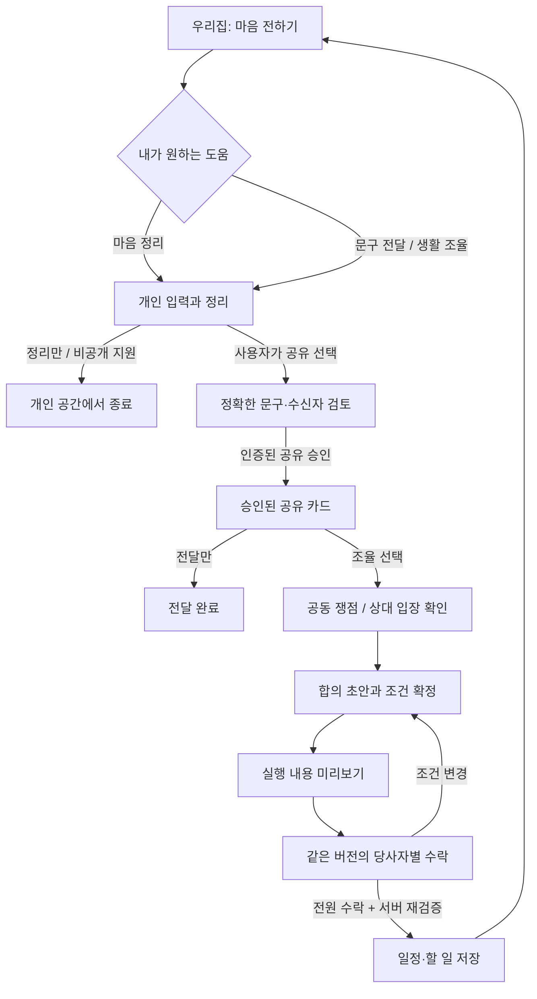

# 우리집 × Relationship AI — 사용자 흐름과 화면 계약

설계일: 2026-11-01. 상태: **구현 제안 / 팀 검토용**. 기존 합의와 실제 코드에 근거한 기능 설계이며 새 화면·백엔드를 구현하거나 브랜치를 병합한 결과가 아니다.

대상은 중고등 자녀를 둔 가족이다. 목표는 일정·기대·책임에 관한 요청을 정리하고, 본인이 승인한 내용만 나누며, 당사자가 수락한 행동을 우리집에 반영하는 것이다. 마음 정리만 하고 끝나는 것도 정상 완료다.

## 1. 기준과 확인된 현재 상태

- 사용자 구현 지시 「Family OS — Relationship AI 구현 지시」가 최초 조사 자료보다 우선한다. 웹/Vercel, 독립 AI 패키지, 호스트의 인증·저장·승인·실행 책임을 유지한다.
- 앱: 원격 `민경민`, `ef47b6ae2dceeb97ff8cb39e159e532a8de68774`. Git author `brianmin11`. 4개 커밋의 템플릿 → 디자인 기반 → 홈 → 집/캐릭터 움직임을 확인했다.
- AI: `codex/relationship-ai`, `8b4d551`. 공개 계약 schema 1.0, prompt `ko-relationship-4`.
- 원격 fetch 후 확인했다. GitHub 연결 도구는 저장소를 찾지 못해 Git CLI로 읽었다. 앱 브라우저 동작·빌드·DB 통합은 이번 설계에서 실행하지 않았다.

| 코드에서 확인한 사실 | 설계에 미치는 영향 |
|---|---|
| [`/home`](https://github.com/brianmin11/NEXTxVERY-/blob/ef47b6ae2dceeb97ff8cb39e159e532a8de68774/app/home/page.tsx#L9)는 `DEMO_HOME` 전달 | 홈 UI를 재사용하되 인증된 서버 조회로 교체해야 한다 |
| [`HomeSummary`](https://github.com/brianmin11/NEXTxVERY-/blob/ef47b6ae2dceeb97ff8cb39e159e532a8de68774/components/home/home-summary.tsx#L32)의 ‘마음 전하기’는 [안내 시트](https://github.com/brianmin11/NEXTxVERY-/blob/ef47b6ae2dceeb97ff8cb39e159e532a8de68774/components/home/home-detail-sheet.tsx#L178)를 연다 | 실제 작성은 전체 화면으로 연결 |
| [`PrivateNoteCard`](https://github.com/brianmin11/NEXTxVERY-/blob/ef47b6ae2dceeb97ff8cb39e159e532a8de68774/components/woorijip/private-note-card.tsx#L7)는 원문/전달문을 분리하는 표시 컴포넌트 | 작성자 검토에 재사용 가능. 수신자 화면에 원문 props를 전달하지 않는다 |
| [`4탭`](https://github.com/brianmin11/NEXTxVERY-/blob/ef47b6ae2dceeb97ff8cb39e159e532a8de68774/components/woorijip/nav-items.ts#L6), 일정·추억·더보기는 `ComingSoon` | 4탭 유지, 조율은 홈 CTA·알림·더보기에서 진입 |
| [`home.fixture.ts`](https://github.com/brianmin11/NEXTxVERY-/blob/ef47b6ae2dceeb97ff8cb39e159e532a8de68774/lib/home.fixture.ts#L31)는 시작 시각 중심의 일정, 완료 여부 중심의 가사 데이터 | 종료 시각·버전·권한·합의 연결을 위한 실제 도메인 데이터 필요 |
| 앱 트리에 API route, 인증·DB 구현이 없고 package에는 UI 의존성만 존재 | AI를 기존 백엔드에 꽂는 상황이 아니라 호스트 연결 계층을 함께 만들 단계 |
| [앱 MASTER](https://github.com/brianmin11/NEXTxVERY-/blob/ef47b6ae2dceeb97ff8cb39e159e532a8de68774/design-system/woorijip/MASTER.md)는 긴 AI 입력을 전체 화면으로 명시 | 기존 단일 열·폰트·토큰·컴포넌트 유지. 이번 문서는 시각 개편 제안이 아님 |

집 단계·캐릭터 움직임은 시각 연출이다. AI가 가족 화목도를 계산하거나 비공개 감정·응답 속도·거절 여부를 집 상태/벌점에 연결하지 않는다.

## 2. 대표 사용자 흐름

아래 상황은 흐름 설명용 예시다. 이름·요일·문구를 분기 조건이나 고정 응답으로 구현하지 않는다.

### A. 이번 주 저녁 집안일 시간을 조율한다

1. 구성원 A가 홈 ‘마음 전하기’ → ‘생활 일정·역할 조율’을 선택한다. 개인 입력에서 시험 준비와 저녁 집안일 부담을 쓴다.
2. AI가 직접 표현한 감정·원하는 것·제약·모르는 것을 정리한다. 날짜/담당자가 불명확하면 묻고, A가 답하거나 미정으로 남긴다.
3. A가 ‘이유는 빼고 필요한 조건만 전달’을 선택하고 B를 수신자로 지정한다. AI가 **공유 초안**을 만든다.
4. A가 정확한 문구·수신자·목적·유효기간을 검토하고 직접 ‘이 문구 보내기’를 누른다. 서버가 그 버전의 공유 승인을 기록한다. AI 생성만으로 발송하지 않는다.
5. B는 받은 문구만 본다. ‘내 입장 정리’로 들어가 별도의 비공개 입력 → 공유 검토를 거친다. ‘지금은 보류’도 가능하다. A는 B의 개인 입력·AI 이용 여부를 볼 수 없다.
6. 승인된 카드만으로 공통 목표·조건 충돌을 보여 준다. 한쪽 카드만 있으면 ‘다른 당사자의 입장은 아직 확인되지 않았어요’를 표시한다. 답변을 강요하거나 상대 의도를 채우지 않는다.
7. 당사자가 합의 초안을 검토한다. 담당자·시작/종료·반복 종료·예외·알림을 수정하고, 미정 조건을 확정한다. AI 제안은 제안 표시를 유지한다.
8. 서버가 정확한 실행 계획을 만든다. 각 당사자가 같은 버전의 계획을 보고 수락한다. 수정 시 이전 수락은 유효하지 않으며 모두 다시 검토한다.
9. 전원 수락과 최신 권한·출처·일정 충돌 재검증을 마친 뒤 ‘우리집에 반영’을 실행한다. 저장된 일정/할 일을 재조회하고 완료를 표시한다. 알림 전송 실패는 저장 실패와 구분한다.



### B. 마음 정리만 한다

개인 입력 → AI 정리·필요한 질문 → 종료/개인 이력. 공유 카드·가족 알림·일정은 생성하지 않는다. 이후 공유를 원하면 사용자가 경로를 바꿔 별도 검토한다. `private_support` 응답도 개인 화면에만 남기며 사유나 ‘위험 감지’ 상태를 가족 화면에 표시하지 않는다.

### C. 전달만 하고 끝내거나 합의하지 않는다

문구 검토 → 명시적 발송 → 전달 완료에서 끝낼 수 있다. 열람·‘알겠어’·침묵은 합의가 아니다. 공동 조율에서 수정/보류/거절을 동등한 선택으로 둔다. 보류는 재개 가능하며 거절된 초안은 자동 재활성화하지 않는다. 새 제안을 시작하려면 사용자의 별도 행동이 필요하다.

## 3. 화면 목록과 화면별 데이터·액션

아래 새 경로는 **제안**이다. 실제 REST 경로나 DB 스키마를 확정한 것이 아니다. S02~S04는 한 전체 화면 안의 단계로 구현할 수 있다. S06~S08은 같은 조율 상세 화면의 상태별 구성으로 구현할 수 있다.

| ID / 화면·진입 | 보여 줄 데이터·노출 대상 | 사용자 액션 → 서버/엔진 처리 | 완료·예외 상태 |
|---|---|---|---|
| S00 로그인·가족 참가 / 신규 | 본인 계정, 초대 대상 가족, 가입/멤버십 상태. 비가입자에게 가족 자료 비노출 | 로그인·초대 수락 → 서버에서 신원/멤버십 확인 | 초대 만료/이미 참가/가구 없음. 관리자도 개인 이력 열람권 없음 |
| S01 우리집 `/home` / 기존 확장 | 기존 집·구성원·허용 일정·내 할 일·추억 + 본인에게 허용된 요청/검토 항목 | 마음 전하기, 받은 요청 열기, 일정 상세, 할 일 완료 → 서버 조회/CRUD. 홈 조회는 AI 호출 없음 | skeleton/빈 상태/오류. 개인 대화 제목·진행 상태를 가족 공통 데이터에 넣지 않음 |
| S02 개인 입력 `/home/heart/new` / 신규 | 경로 3종, 본인 원문, 저장 안내, 기억 사용 설정, 선택 일정의 허용 요약 | 입력·경로 선택·정리 요청 → `personal(PrivateContext)` | 중단/한도/다시 시도. 개인 전용 draft 저장, 공용 브라우저 캐시에 원문 저장하지 않음 |
| S03 내 표현 정리 / S02 다음 | `response`, `claims`, 근거 구절, `unknowns`, `questions`, `disposition`. 본인만 | 답변·입력 정정 → 새 source revision과 `personal`; 종료; 경로 변경 후 공유 문구 만들기 | 질문 최대 3개, 반복 2회 이후 미확인 항목으로 남김. `private_support`는 개인 지원 경로 |
| S04 공유 문구 검토 / 신규 | `ShareCardDraft.exactText/recipients/purpose/revision/reviewItems`, 호스트 유효기간, constraintsOnly 설정. 본인만 | 문구 직접 수정·조건만 전달·수신자 선택·다시 다듬기(`share`)·정확한 버전 보내기(서버 승인) | 생성≠발송. 수정/수신자/목적 변경은 새 버전. 공유 승인 저장 실패 시 미전달 유지 |
| S05 받은 요청 `/home/requests/[id]` / 신규 | 승인 문구·발신자·수신 범위·공유 시점·유효 상태. 승인된 수신자만 | 읽기, 내 입장 정리(S02), 조율 참여, 보류. 전달만이면 여기서 끝 | 철회/만료는 내용 재노출 차단. ‘읽음’과 ‘수락’ 분리. 강제 재촉 없음 |
| S06 함께 조율 `/home/coordination/[id]` / 신규 | 현재 승인 카드, `IssueAnalysis`, 확인되지 않은 당사자. 해당 audience만 | 쟁점 확인(`analyze`), 본인 공유 내용 정정, 합의 초안 요청(`propose`) | 한쪽 입장만이면 미확인 표시. 신규 카드/철회/범위 변경 시 분석·초안 stale 처리 |
| S07 합의 초안 / S06 상태 | `AgreementDraft` 요약·선택지·행동·미정 필드·버전 차이, 각 조건의 제안 표시 | 수정 요청을 **공유될 내용으로 확인** 후 `revise`; 보류/거절; 구조화 폼에서 조건 확정 | 새 버전은 수락 초기화. 개인 사유를 쓰고 싶으면 S02로 이동. options는 현재 문자열이라 클릭만으로 실행 행동 전환 불가 |
| S08 실행 미리보기·수락 / S07 다음 | 정확한 일정/할 일 변경 전후, 시간대, 참여자/담당자, 알림, 차단 항목, 버전별 당사자 수락 상태 | 필수값 보완 → 새 실행 계획; 본인 ‘이 내용 수락’; 전원 수락 후 ‘우리집에 반영’ | `ChangePlanDraft.executable=false` 유지. 필수값·권한·시간 검증 실패는 수락 차단. 수락 대기만 남으면 수락 가능, 전원 수락 전 실행 불가 |
| S09 반영 결과·일정 `/calendar` / 기존 확장 | DB에서 재조회한 일정/할 일, 합의 버전 링크, 저장/알림 상태 | 상세 조회·할 일 완료·변경 제안·명시적 되돌리기 요청 | 중복 요청은 같은 결과 반환. 실패는 저장 전/저장 후 알림 실패 구분. 되돌리기는 새 권한 검사와 변경 절차 |
| S10 개인 이력·기억 설정 `/more/privacy` / 신규 | 본인 대화 이력, 기억 사용 여부, 삭제 상태, 본인이 공유한 카드의 범위/철회 상태 | 기억 끄기, 이력 삭제/정정, 공유 철회 → 호스트 저장·무효화 처리 | 기억 끄기≠삭제≠공유 철회. 이미 독립 승인된 합의의 처리도 별도 안내 |
| S11 알림·진행 목록 / 기존 시트·더보기 확장 | 내 수신 요청·검토 필요 합의·반영 결과, 서버가 정한 상태/딥링크 | 대상 열기, 읽음 처리 | 권한 재검사 후 조회. 잠금 화면/알림 payload에는 개인 원문·갈등 사유·안전 판정 미포함 |

추억 `/memories`, 캐릭터 꾸미기, 집 성장 정책은 현재 UI 방향을 유지하고 이 AI 연결 작업의 우선 구현에서 제외한다. ‘더보기’에는 가사·마음 전하기 이력·설정 진입을 둔다. 사진의 `MemoryItem`과 AI 개인 기억은 다른 개념이며 데이터도 이름도 분리한다.

## 4. 대표 화면 구성과 문구

S04 공유 검토는 기존 `PrivateNoteCard`의 시각 구조를 사용한다. 편집 가능한 입력과 수신자/목적/유효기간을 추가하되, 원문이 있는 작성자 화면과 수신자 전용 공유 카드 컴포넌트를 나눈다.

```text
공유 문구 확인                         나만 보는 초안
받는 사람  [선택된 구성원]     목적 [이 일정 조율]
이 내용은 선택한 사람에게만 전달돼요.

전달할 문장 [직접 수정 가능한 문구]
검토할 항목 [날짜 미정 / 요청 강도 등]
이유를 빼고 필요한 조건만 전달 [선택]

[다시 다듬기]                     [이 문구 보내기]
```

S08은 ‘합의했어요’라는 추상 버튼 대신 사용자가 수락하는 대상 자체를 보여 준다.

```text
우리집에 반영할 내용                     버전 3
일정 변경  기존 시간 → 새 시작·종료 / 시간대
역할       담당자 / 참여자 / 기한 / 반복 종료
예외       못 하는 날의 처리
알림       받는 사람 / 시각 / 횟수
아직 정하지 않은 항목                    0개

당사자 A 수락 · 당사자 B 검토 중
[수정 요청] [보류] [거절]            [이 내용 수락]
전원 수락 후 별도 버튼: [우리집에 반영]
```

개인 화면에서는 ‘내가 확인하고 보내기 전에는 전달되지 않아요’, 공동 화면에서는 ‘공유된 내용만으로 정리했어요’를 사용한다. 모델명·토큰·permissionEpoch·semanticHash는 개발 계약에만 두고 일반 화면에 노출하지 않는다.

## 5. UX 상태와 접근성 기준

- 기존 MASTER의 단일 열, shadcn, Pretendard/Cal Sans, 기존 토큰, 44px 터치 영역을 유지한다. 홈 장면과 기능 UI를 섞지 않는다. 새 시각 방향 승인은 이번 작업에 포함하지 않는다.
- 작성·검토는 전체 화면, 짧은 상세는 기존 단일 시트. 뒤로 가기 시 공유 여부를 명확히 하고 비공개 draft 복구를 지원한다. 시트 중첩 금지, 닫을 때 트리거로 포커스 복귀.
- 단계 이름은 ‘내 이야기 → 공유 검토 → 함께 조율’처럼 현재 위치를 설명한다. 마음 정리만 하는 경로에 미완료 진행률을 강요하지 않는다.
- 로딩은 실제 진행 상태 문구·취소·`aria-busy`; 긴 작업에서 가짜 퍼센트 금지. 오류는 `role=alert`와 복구 행동, 필드 오류는 해당 입력에 연결한다.
- 검증된 AI 결과가 오기 전 공유·수락 버튼을 활성화하지 않는다. 새로고침/중복 클릭에서 같은 요청이 중복 발송·실행되지 않아야 한다.
- 서버 인증/공급자 장애는 ‘지금 정리를 완료하지 못했어요. 입력은 보관돼 있어요’ 등 실제 저장 상태에 맞게 표시한다. 저장하지 못했다면 보관됐다고 안내하지 않는다.
- 360/390/430px, 키보드 입력, 긴 한국어/이름, 포커스 이동, reduced-motion, 빈 상태·만료·철회·모델 실패를 후속 구현에서 확인한다. **이 체크리스트는 이번에 브라우저 통과한 증거가 아니다.**

## 6. 첫 연결 범위와 완료 기준

첫 구현은 **두 계정의 개인 입력 → 승인 공유 → 공동 초안 → 한 건의 일정 변경 → 재조회**로 권장한다. 일정 참여자/종료 시각을 확정한 뒤 붙인다. 부모·자녀 역할을 바꿔도 권한·선택권이 같아야 한다. 초기에는 실제 미성년자 데이터 대신 승인된 합성/테스트 데이터로 연결을 검증한다.

합격 증거는 두 로그인 세션의 화면 조작, 다른 가구/수신자 접근 거부, 개인 원문 비노출, 수정 후 과거 수락 차단, 최종 일정 1회 저장·재조회, 철회/충돌/중복/모델 실패 복구다. 엔진의 기존 89개 테스트·32개 합성 평가는 이 통합 증거를 대신하지 않는다.

후속 기능 순서는 가사/역할 배정 → 알림 정책·후속 확인으로 제안한다. 추억 업로드·외부 캘린더·과금 상품·집 성장 정책은 별도 범위 결정이다. 월 한도 수치와 가격, 연령별 실제 출시 조건, 승인 합의 보존 정책, 초안·공유 카드 유효기간은 아직 확정하지 않는다.

상세 서버 연결과 엔진 조정은 [AI-PIPELINE-DESIGN.md](AI-PIPELINE-DESIGN.md)를 따른다.
